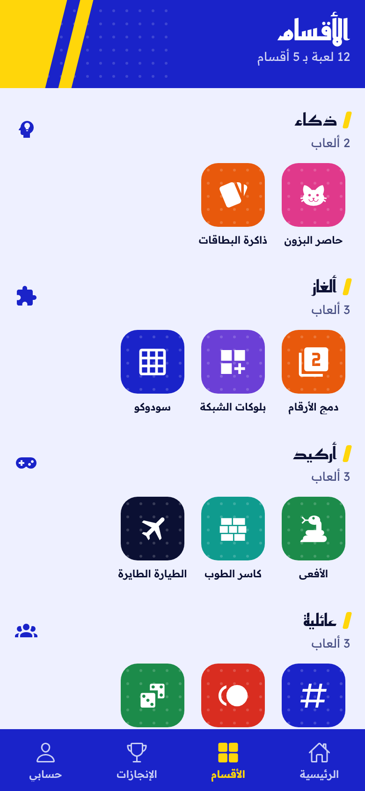

# Spir Games 🎮

منصة أندرويد عربية فيها ألعاب بسيطة للأعمار من 5 إلى 50 سنة، مجانية بالكامل، تشتغل بدون إنترنت، ويّا ملفات للعائلة ووضع للأهل.

- 📄 [الخطة الكاملة](docs/PLAN.md)
- 🎨 [تصوّر الشاشات](docs/mockups/) — صور PNG + ملف `index.html`


**التقنية:** Expo (React Native) نفس مشروع «بالملعب» + ألعاب HTML5 داخل WebView يربطها SDK موحّد (`spir-sdk.js`).
**الهوية:** نظام التصميم «ملكي» من بالملعب (أزرق ملكي، أصفر، كحلي، خط Reem Kufi للعناوين و Readex Pro للنص).

## الحالة

- ✅ **المرحلة 0 — التأسيس:** مشروع Expo بهوية «ملكي»، الشريط السفلي (الرئيسية، الأقسام، الإنجازات، حسابي)، فهرس الألعاب (13 لعبة ويّا «نزّل البزون»)، صفحة اللعبة، تبديل الثيمات والوضع الداكن، وبناء APK والويب على GitHub Actions.
- ⏳ **المرحلة 1:** `spir-kit` + المشغّل + «حاصر البزون» كأول لعبة.

| الرئيسية | صفحة اللعبة | الأقسام | الإنجازات | حسابي (داكن) |
|---|---|---|---|---|
|  |  |  |  |  |

## التشغيل محلياً

```bash
cd apps/mobile
npm install
npm run web        # بالمتصفح
npm start          # ويّا تطبيق Expo Go / جهاز
npm run typecheck && npm run lint && npm test
```

## تنزيل الـ APK

1. تبويب **Actions** ← **Android APK** ← **Run workflow** واختار الفرع.
2. بعد ما يخلص، نزّل **spir-games-android** من أسفل صفحة التشغيل (zip فيه الـ APK).
3. انقله للهاتف وثبّته (اسمح بالتثبيت من مصادر غير معروفة).

للنشر كتحديث: غيّر `version` في `apps/mobile/app.json` وشغّل الـ workflow مع **«انشر كإصدار»**.

**التوقيع (اختياري لكن مهم قبل التوزيع):** أضف بـ Settings ← Secrets ← Actions:
`ANDROID_KEYSTORE_BASE64` و `ANDROID_KEYSTORE_PASSWORD` (اسم المفتاح `spir`). بدونها النسخة تتوقع بالمفتاح التجريبي، وما تكدر تحدّثها فوق بعدين بمفتاح ثاني.

## نسخة الآيفون (ويب آب)

1. **Settings ← Pages ← Source: GitHub Actions** (مرة وحدة).
2. بعد الدمج بالفرع `main` يُنشر على `https://inzohussein-blip.github.io/spir-game-center/`.
3. بالآيفون: افتح الرابط بـ Safari ← مشاركة ← **إضافة إلى الشاشة الرئيسية**.
