# Spir Games — عالم سبير 🐱

عالم ألعاب عربي للأعمار من 5 إلى 50 سنة، مجاني بالكامل وبدون إعلانات، يشتغل بدون نت.
الشخصية الرئيسية **سبير** (بزون برتقالي بوشاح أزرق) يرافق اللاعب على **خريطة جزيرة** بيها مكان لكل لعبة، ويّا **بيت** يزيّنه و**ألبوم ملصقات** يجمعه.

| الخريطة | نزّل البزون | حاصر البزون | دمج المخلوقات | بلوكات الحلوى |
|---|---|---|---|---|
| 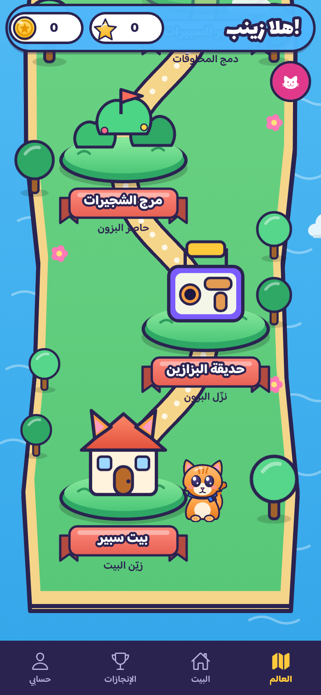 | 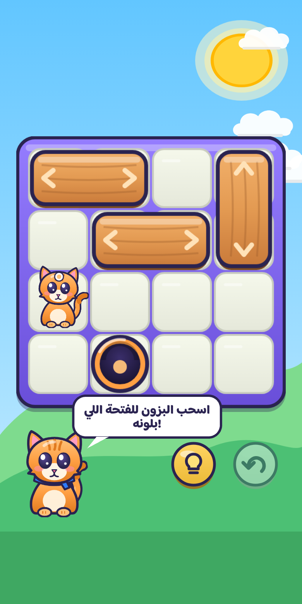 | 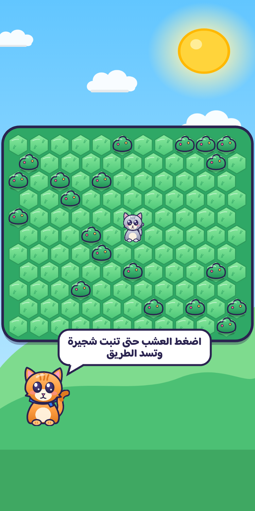 | 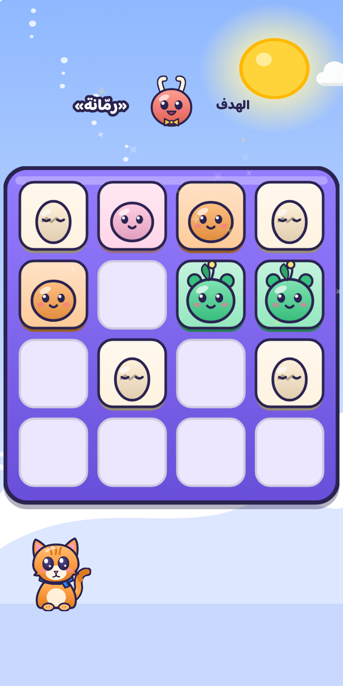 | 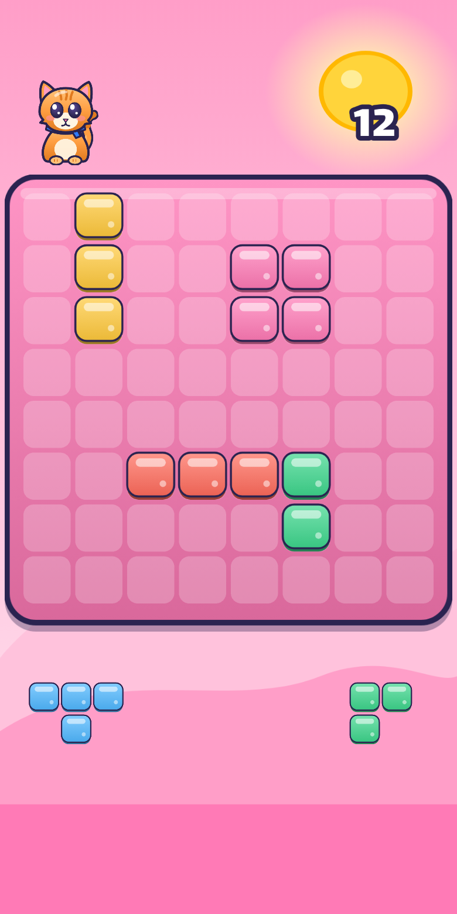 |

| أربعة بخط | بيت سبير | الألبوم | نهاية المرحلة | صفحة اللعبة |
|---|---|---|---|---|
| 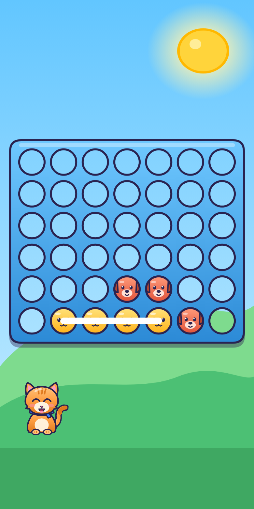 | 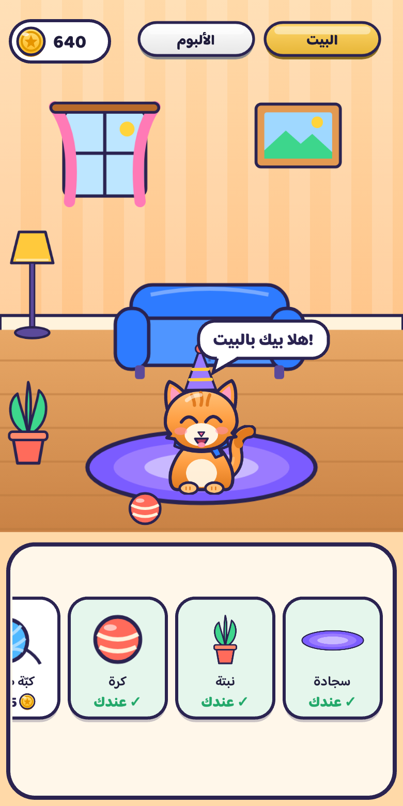 | 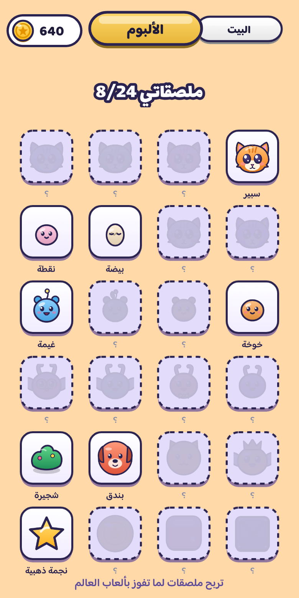 | 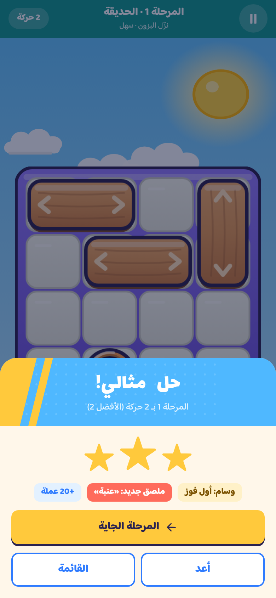 | 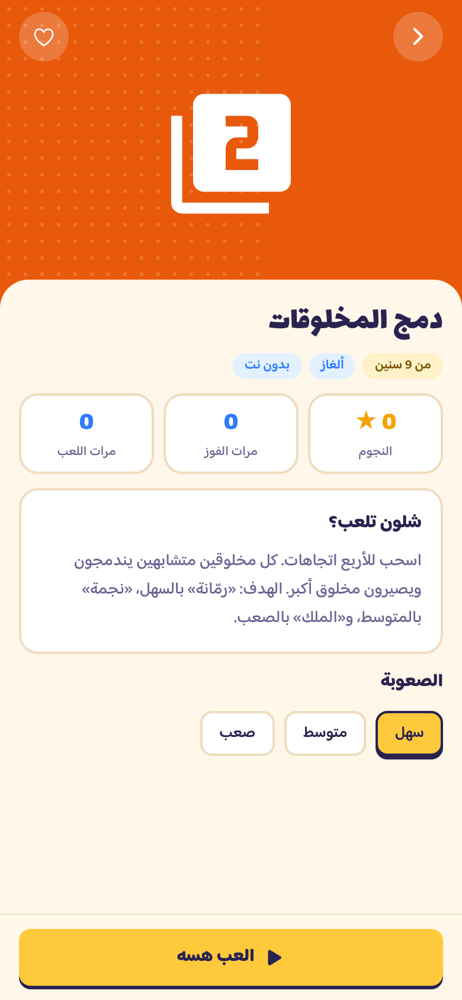 |

- 📄 [خطة «عالم سبير» (الإصدار 0.2)](docs/PLAN-v2.md) · [الخطة الأولى](docs/PLAN.md) · [دليل الإطلاق](docs/RELEASE.md)

## شنو بيه

- **5 ألعاب رئيسية** بمحرك PixiJS ورسوم كرتونية وشخصيات متحركة: نزّل البزون (120 مرحلة)، حاصر البزون، دمج المخلوقات (11 مخلوق)، بلوكات الحلوى، أربعة بخط (ضد «بندق» أو لاعبين).
- **8 ألعاب كلاسيكية** بـ «صالة الكلاسيكيات».
- **بيت سبير**: 12 غرض و4 قبعات بالعملات. **الألبوم**: 24 ملصق تنربح من الألعاب الرئيسية.
- **العائلة**: ملفات بدون تسجيل، وضع أهل برمز وحد يومي، وتحدّي العائلة الأسبوعي.
- **تحدّي اليوم** (+50 عملة) عليه شارة على الخريطة، و8 أوسمة، وتحديث من داخل التطبيق.

## البنية

```
packages/spir-art/     رسوم SVG بالكود (سبير وتعابيره، القطع، الخلفيات، البنايات، المخلوقات، الأثاث)
packages/spir-engine/  محرك فوق PixiJS: مشهد، حركات، جزيئات، صوت وموسيقى مولّدة، نص عربي، أزرار، بزون متحرك
packages/spir-kit/     المحرك الخفيف (Canvas) للكلاسيكيات + جسر الرسائل ويّا التطبيق
games/<id>/            كل لعبة/مشهد: game.json + main.ts + logic.ts + اختبارات
apps/mobile/           تطبيق Expo: الخريطة والبيت والألعاب ملفات HTML تنحمّل وقت تنفتح
```

## الحالة

- ✅ **الإصدار 0.2.1:** رجع ترتيب المتجر القديم (الرئيسية · الأقسام · الإنجازات · حسابي) والثيم الأزرق الملكي كافتراضي، ويّا الحفاظ على كل الجديد: ألعاب سبير الخمسة بأغلفتها (صف خاص بالرئيسية)، بيت سبير والألبوم والخريطة (بطاقات من الرئيسية)، الأصوات والرسوميات. ثيم «سبير» باقي اختيار بـ «حسابي». شعار جديد يشبه شعار 0.1.2 (يد تحكم بأذنين بزون).

- ✅ **الإصدار 0.2 — عالم سبير:** المحرك الجديد، الخريطة، 5 ألعاب رئيسية بالرسوم الجديدة، البيت والألبوم، تحدّي العائلة، الهوية الجديدة (ألوان سبير وخط Baloo Bhaijaan 2 وLalezar) وأيقونة جديدة.

- ✅ **المرحلة 0 — التأسيس:** مشروع Expo بهوية «ملكي»، الشريط السفلي (الرئيسية، الأقسام، الإنجازات، حسابي)، فهرس الألعاب (13 لعبة ويّا «نزّل البزون»)، صفحة اللعبة، تبديل الثيمات والوضع الداكن، وبناء APK والويب على GitHub Actions.
- ✅ **المرحلة 1 — المحرك والمشغّل وأول 4 ألعاب:**
  - محرك `spir-kit` (Canvas 2D) + جسر `spir-sdk` بين اللعبة والتطبيق.
  - المشغّل الموحّد: شريط علوي، قائمة إيقاف، نافذة نهاية بالنجوم والعملات.
  - حفظ التقدّم على الجهاز: المراحل، النجوم، العملات، المستوى، والأوسمة.
  - الألعاب: **حاصر البزون** (30 مرحلة × 3 صعوبات)، **نزّل البزون** (60 مرحلة مولّدة ومحلولة بالمحلّل، ومؤقت بالصعب)، **إكس أو** (ضد الجهاز أو لاعبين)، **ذاكرة البطاقات** (12 مرحلة).
- ✅ **المرحلة 2 — MVP كامل:**
  - **ملفات العائلة** («منو يلعب؟») بدون تسجيل دخول: اسم، عمر (5–50)، صورة رمزية. كل ملف إله نجومه وعملاته، والألعاب تطلع حسب عمره.
  - **وضع الأهل** برمز 4 أرقام: حد يومي للعب («كافي لليوم!»)، تعديل الأعمار، إخفاء ألعاب، ومسح الملفات.
  - **تحدّي اليوم** بمكافأة +50 عملة مرة باليوم، **المفضلة**، وتشغيل/إطفاء الأصوات.
  - 9 ألعاب جديدة: دمج الأرقام، بلوكات الشبكة، الأفعى، أربعة بخط، كاسر الطوب، الطيارة الطايرة، سودوكو، البحث عن الكلمات، دومينو — **المجموع 13 لعبة**.
- 🟡 **المرحلة 3 — الإطلاق:** سياسة الخصوصية وبناء AAB ودليل [`docs/RELEASE.md`](docs/RELEASE.md) جاهزين؛ الباقي (مفتاح التوقيع وحساب Google Play) يحتاجك.

## إضافة لعبة جديدة

1. مجلّد `games/<id>/` فيه `game.json` (ويّا `license`) و`main.ts` يستعمل `createGame` من `packages/spir-kit`.
2. المنطق الصافي بـ `logic.ts` ويّا اختبارات `logic.test.mts`.
3. `cd apps/mobile && npm run build:games` — يبني كل لعبة لملف HTML واحد ويعلّمها «جاهزة» بالتطبيق.
4. مراحل «نزّل البزون» تتولّد بـ `npm run levels:drop-cat` (كل مرحلة يتأكد المحلّل إنها تنحل).

| الرئيسية | صفحة اللعبة | الأقسام | الإنجازات | حسابي (داكن) |
|---|---|---|---|---|
|  | 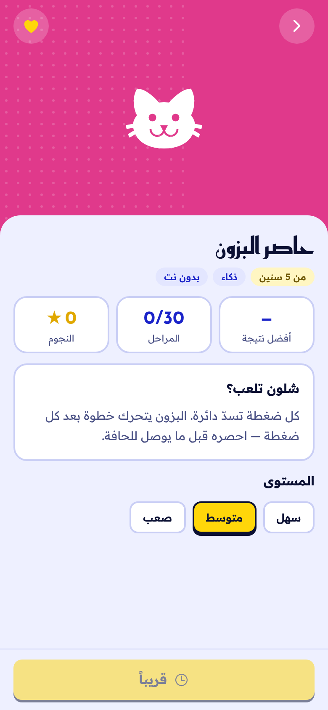 |  | 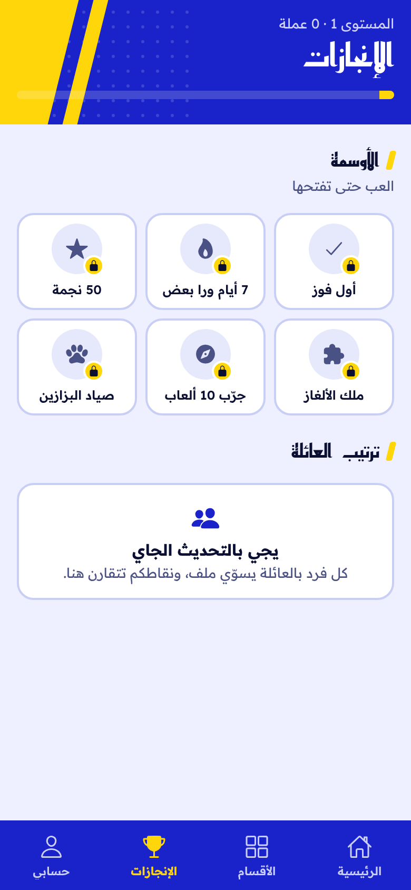 |  |

## التشغيل محلياً

```bash
cd apps/mobile
npm install
npm run web        # بالمتصفح
npm start          # ويّا تطبيق Expo Go / جهاز
npm run build:games   # بعد أي تعديل على مجلد games/
npm run typecheck && npm run lint && npm test
```

## التحديث من داخل التطبيق

- **الأندرويد:** التطبيق يقارن رقم نسخته بآخر إصدار منشور بتبويب **Releases** فيه ملف APK. إذا أكو أحدث يطلع شريط أصفر بالرئيسية، وبـ «حسابي ← التحديثات» زر **«حدّث للنسخة …»** ينزّل الملف، والهاتف يثبّته فوق القديم وتبقى ملفات العائلة والنجوم.
- **الآيفون (ويب):** يقارن رقم البناء بملف `version.json` المنشور ويّا الموقع، وزر «حدّث هسه» يفتح النسخة الجديدة.
- حتى يوصل التحديث للكل: غيّر `version` بـ `apps/mobile/app.json` وشغّل **Android APK** ويّا **«انشر كإصدار»**.
- ⚠️ لازم كل النسخ تتوقّع بنفس المفتاح (شوف `docs/RELEASE.md`)، وإلا التلفون يرفض التحديث.

## تنزيل الـ APK

1. تبويب **Actions** ← **Android APK** ← **Run workflow** واختار الفرع.
2. بعد ما يخلص، نزّل **spir-games-android** من أسفل صفحة التشغيل (zip فيه الـ APK).
3. انقله للهاتف وثبّته (اسمح بالتثبيت من مصادر غير معروفة).

للنشر كتحديث: غيّر `version` في `apps/mobile/app.json` وشغّل الـ workflow مع **«انشر كإصدار»**.

**التوقيع (اختياري لكن مهم قبل التوزيع):** أضف بـ Settings ← Secrets ← Actions:
`ANDROID_KEYSTORE_BASE64` و `ANDROID_KEYSTORE_PASSWORD` (اسم المفتاح `spir`). بدونها النسخة تتوقع بالمفتاح التجريبي، وما تكدر تحدّثها فوق بعدين بمفتاح ثاني.

## نسخة الآيفون (ويب آب)

1. **Settings ← Pages ← Source: GitHub Actions** (مرة وحدة).
2. بعد الدمج بالفرع `main` يُنشر على `https://inzohussein-blip.github.io/spir-game-center/`.
3. بالآيفون: افتح الرابط بـ Safari ← مشاركة ← **إضافة إلى الشاشة الرئيسية**.

### الألعاب (المرحلة 1)

| حاصر البزون | نزّل البزون (صعب) | نهاية المرحلة | إكس أو | ذاكرة البطاقات | صفحة اللعبة |
|---|---|---|---|---|---|
| 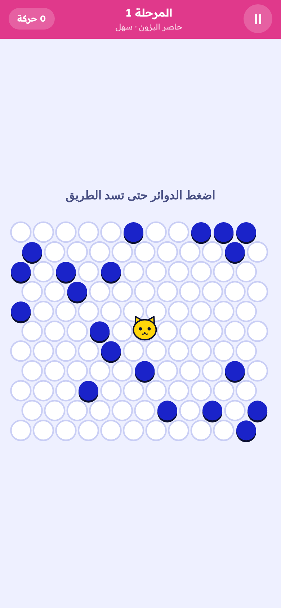 |  |  | 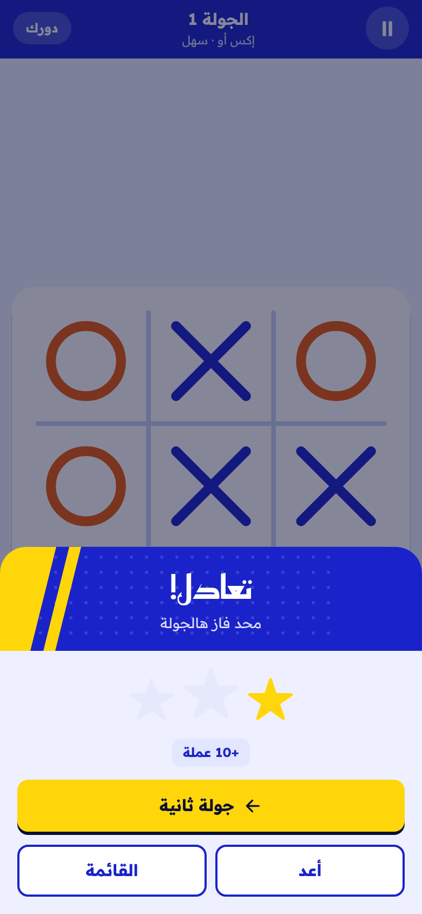 | 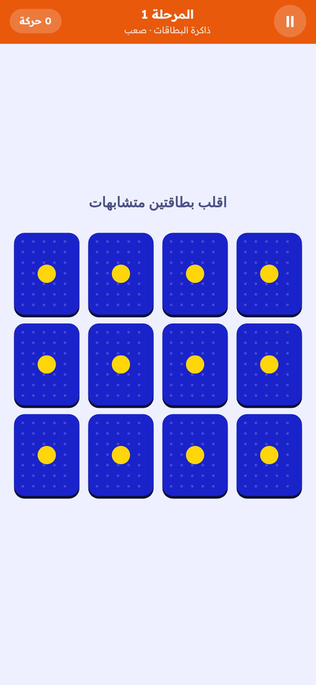 | 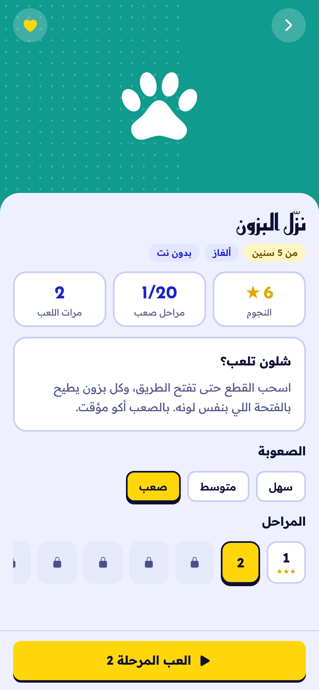 |

### المرحلة 2

| منو يلعب؟ | وضع الأهل | دمج الأرقام | بلوكات الشبكة | الأفعى | أربعة بخط |
|---|---|---|---|---|---|
|  |  |  |  | 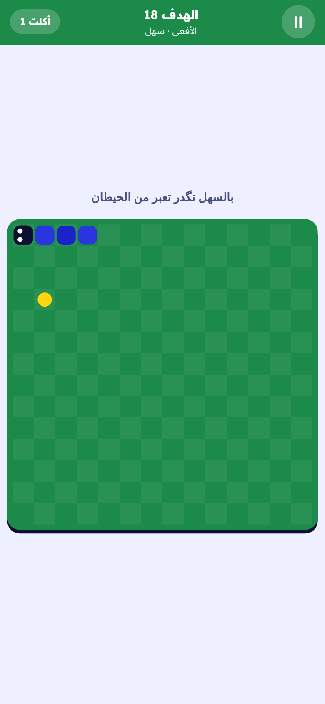 |  |

| كاسر الطوب | سودوكو | البحث عن الكلمات | دومينو | أول مرة |
|---|---|---|---|---|
|  |  | 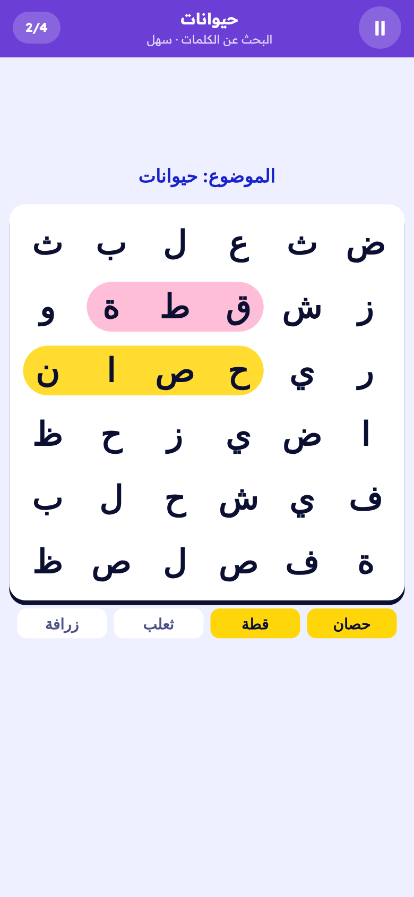 |  | 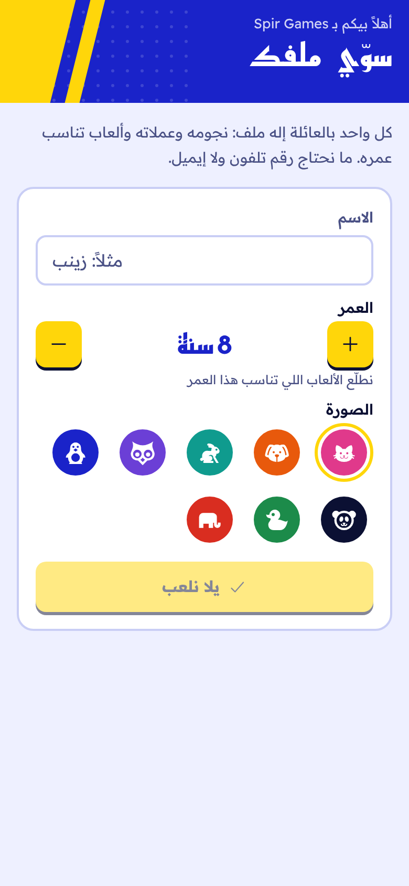 |
