# Spir Games 🎮

منصة أندرويد عربية فيها ألعاب بسيطة للأعمار من 5 إلى 50 سنة، مجانية بالكامل، تشتغل بدون إنترنت، ويّا ملفات للعائلة ووضع للأهل.

- 📄 [الخطة الكاملة](docs/PLAN.md)
- 🎨 [تصوّر الشاشات](docs/mockups/) — صور PNG + ملف `index.html`

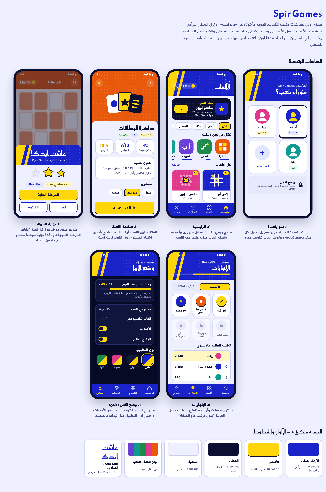

**التقنية:** Expo (React Native) نفس مشروع «بالملعب» + ألعاب HTML5 داخل WebView يربطها SDK موحّد (`spir-sdk.js`).
**الهوية:** نظام التصميم «ملكي» من بالملعب (أزرق ملكي، أصفر، كحلي، خط Reem Kufi للعناوين و Readex Pro للنص).

## الحالة

- ✅ **المرحلة 0 — التأسيس:** مشروع Expo بهوية «ملكي»، الشريط السفلي (الرئيسية، الأقسام، الإنجازات، حسابي)، فهرس الألعاب (13 لعبة ويّا «نزّل البزون»)، صفحة اللعبة، تبديل الثيمات والوضع الداكن، وبناء APK والويب على GitHub Actions.
- ✅ **المرحلة 1 — المحرك والمشغّل وأول 4 ألعاب:**
  - محرك `spir-kit` (Canvas 2D) + جسر `spir-sdk` بين اللعبة والتطبيق.
  - المشغّل الموحّد: شريط علوي، قائمة إيقاف، نافذة نهاية بالنجوم والعملات.
  - حفظ التقدّم على الجهاز: المراحل، النجوم، العملات، المستوى، والأوسمة.
  - الألعاب: **حاصر البزون** (30 مرحلة × 3 صعوبات)، **نزّل البزون** (60 مرحلة مولّدة ومحلولة بالمحلّل، ومؤقت بالصعب)، **إكس أو** (ضد الجهاز أو لاعبين)، **ذاكرة البطاقات** (12 مرحلة).
- ✅ **المرحلة 2 — MVP كامل:**
  - **ملفات العائلة** («منو يلعب؟») بدون تسجيل دخول: اسم، عمر (5–50)، صورة رمزية. كل ملف إله نجومه وعملاته، والألعاب تطلع حسب عمره.
  - **وضع الأهل** برمز 4 أرقام: حد يومي للعب («كافي لليوم!»)، تعديل الأعمار، إخفاء ألعاب، ومسح الملفات.
  - **تحدّي اليوم** بمكافأة +50 عملة مرة باليوم، **المفضلة**، وتشغيل/إطفاء الأصوات.
  - 9 ألعاب جديدة: دمج الأرقام، بلوكات الشبكة، الأفعى، أربعة بخط، كاسر الطوب، الطيارة الطايرة، سودوكو، البحث عن الكلمات، دومينو — **المجموع 13 لعبة**.
- 🟡 **المرحلة 3 — الإطلاق:** سياسة الخصوصية وبناء AAB ودليل [`docs/RELEASE.md`](docs/RELEASE.md) جاهزين؛ الباقي (مفتاح التوقيع وحساب Google Play) يحتاجك.

## إضافة لعبة جديدة

1. مجلّد `games/<id>/` فيه `game.json` (ويّا `license`) و`main.ts` يستعمل `createGame` من `packages/spir-kit`.
2. المنطق الصافي بـ `logic.ts` ويّا اختبارات `logic.test.mts`.
3. `cd apps/mobile && npm run build:games` — يبني كل لعبة لملف HTML واحد ويعلّمها «جاهزة» بالتطبيق.
4. مراحل «نزّل البزون» تتولّد بـ `npm run levels:drop-cat` (كل مرحلة يتأكد المحلّل إنها تنحل).

| الرئيسية | صفحة اللعبة | الأقسام | الإنجازات | حسابي (داكن) |
|---|---|---|---|---|
| 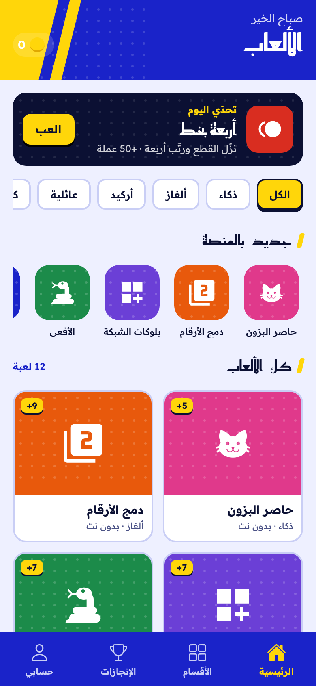 |  |  |  | 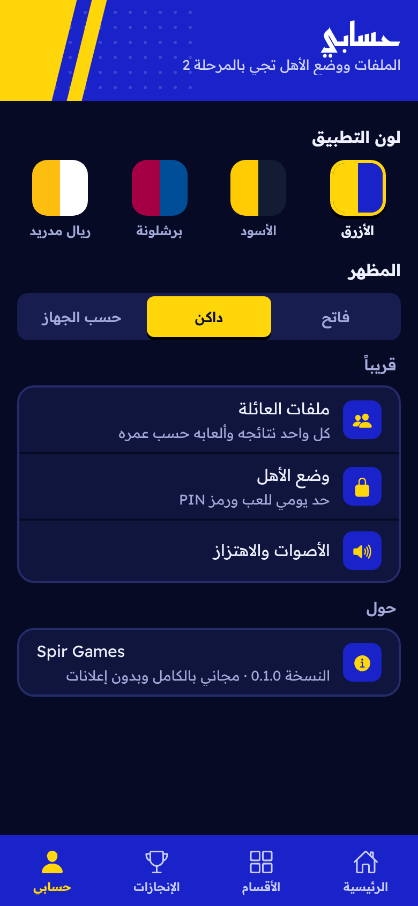 |

## التشغيل محلياً

```bash
cd apps/mobile
npm install
npm run web        # بالمتصفح
npm start          # ويّا تطبيق Expo Go / جهاز
npm run build:games   # بعد أي تعديل على مجلد games/
npm run typecheck && npm run lint && npm test
```

## تنزيل الـ APK

1. تبويب **Actions** ← **Android APK** ← **Run workflow** واختار الفرع.
2. بعد ما يخلص، نزّل **spir-games-android** من أسفل صفحة التشغيل (zip فيه الـ APK).
3. انقله للهاتف وثبّته (اسمح بالتثبيت من مصادر غير معروفة).

للنشر كتحديث: غيّر `version` في `apps/mobile/app.json` وشغّل الـ workflow مع **«انشر كإصدار»**.

**التوقيع (اختياري لكن مهم قبل التوزيع):** أضف بـ Settings ← Secrets ← Actions:
`ANDROID_KEYSTORE_BASE64` و `ANDROID_KEYSTORE_PASSWORD` (اسم المفتاح `spir`). بدونها النسخة تتوقع بالمفتاح التجريبي، وما تكدر تحدّثها فوق بعدين بمفتاح ثاني.

## نسخة الآيفون (ويب آب)

1. **Settings ← Pages ← Source: GitHub Actions** (مرة وحدة).
2. بعد الدمج بالفرع `main` يُنشر على `https://inzohussein-blip.github.io/spir-game-center/`.
3. بالآيفون: افتح الرابط بـ Safari ← مشاركة ← **إضافة إلى الشاشة الرئيسية**.

### الألعاب (المرحلة 1)

| حاصر البزون | نزّل البزون (صعب) | نهاية المرحلة | إكس أو | ذاكرة البطاقات | صفحة اللعبة |
|---|---|---|---|---|---|
|  | 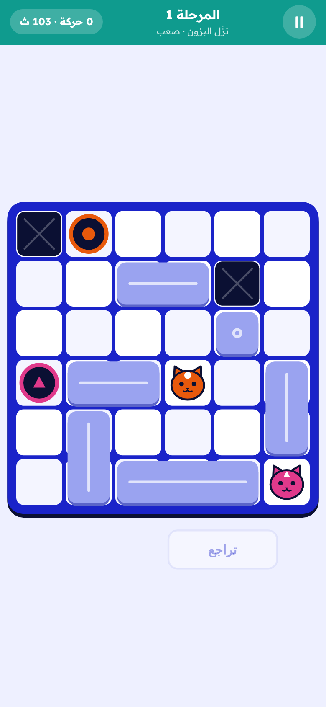 | 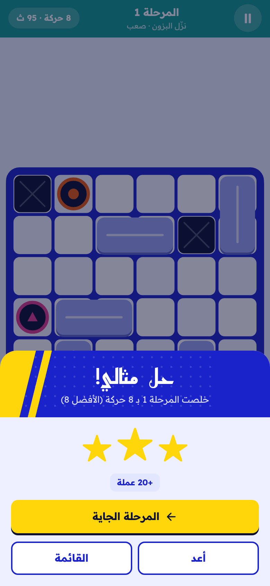 |  |  |  |

### المرحلة 2

| منو يلعب؟ | وضع الأهل | دمج الأرقام | بلوكات الشبكة | الأفعى | أربعة بخط |
|---|---|---|---|---|---|
|  | 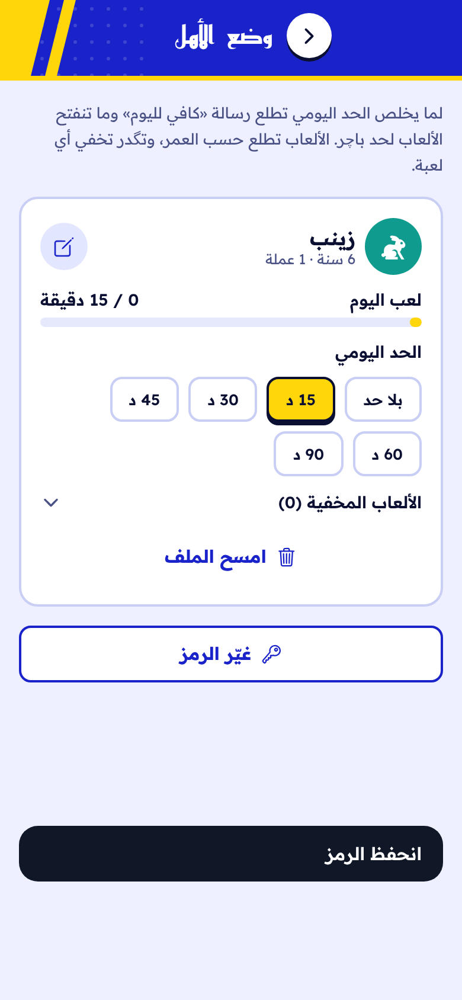 | 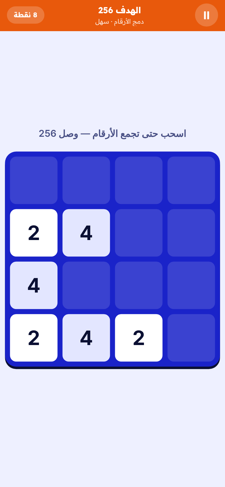 | 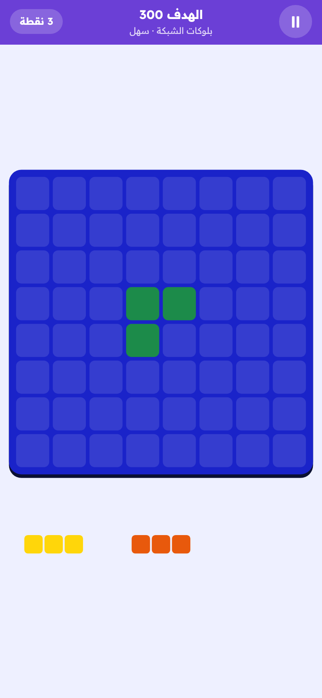 |  | 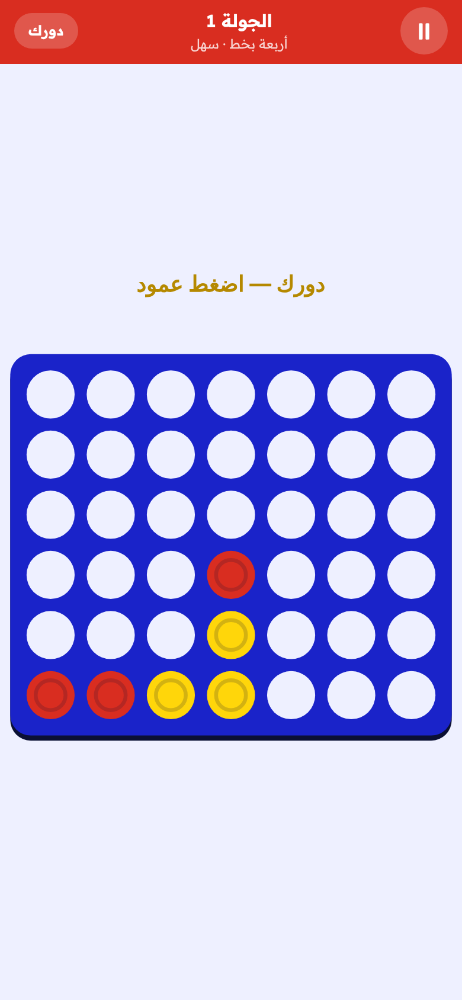 |

| كاسر الطوب | سودوكو | البحث عن الكلمات | دومينو | أول مرة |
|---|---|---|---|---|
| 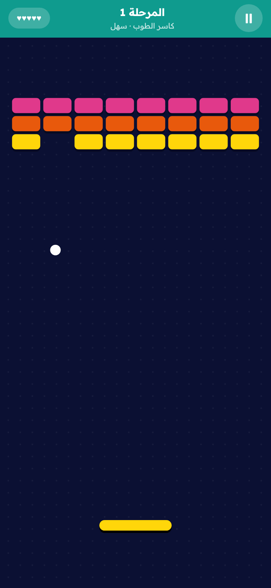 | 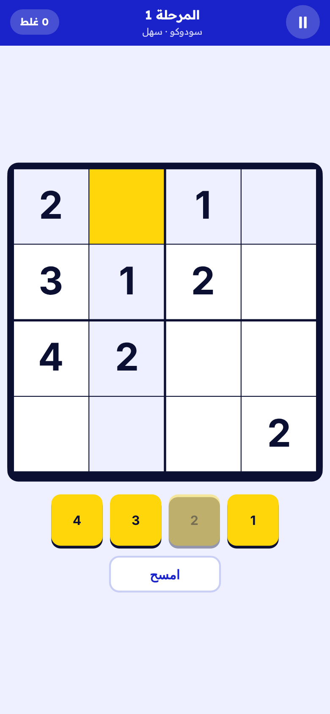 |  | 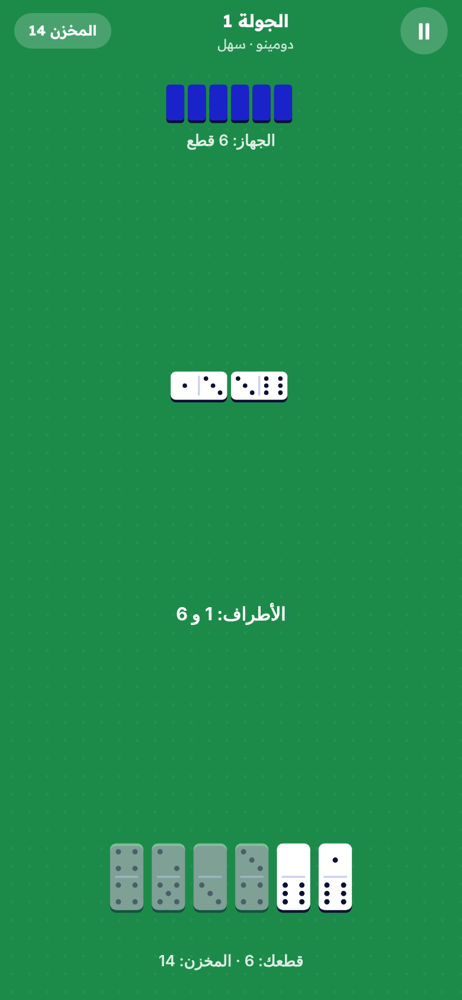 |  |
