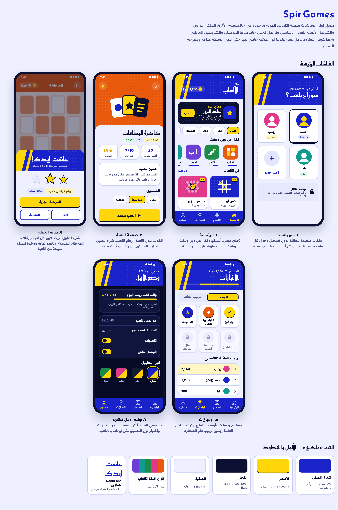

# خطة مشروع Spir Games 🎮

> منصة أندرويد عربية فيها ألعاب بسيطة تناسب الأعمار **من 5 إلى 50 سنة**، تشتغل بدون إنترنت، ويّا ملفات للعائلة ووضع للأهل.
> **مجانية بالكامل** (بدون إعلانات وبدون مشتريات) — APK للأندرويد + ويب آب للآيفون.

## القرارات المعتمدة

| السؤال | القرار |
|---|---|
| الاسم | **Spir Games** |
| الأعمار | من 5 إلى 50 سنة |
| الربح | مجاني بالكامل حالياً |
| المنصات | APK للأندرويد (GitHub Releases) + PWA للآيفون (GitHub Pages) |
| الألعاب | الأكثر طلباً + **حاصر البزون** (نوع «Trap the Cat») + **نزّل البزون** (نوع «Drop the Cat») — القسم 6 |
| الثيم | «ملكي» نفسه من بالملعب بدون تغيير |
| محرك الألعاب | **Canvas 2D + مكتبة خفيفة نكتبها `spir-kit`** — القسم 3.5 |
> المنصات: **تطبيق أندرويد** (أساسي) + **ويب آب PWA** للآيفون من نفس الكود.
> اللغة: **العربية بالكامل (RTL)**.
> الهوية: نفس نظام التصميم «ملكي» من مشروع [بالملعب](https://github.com/inzohussein-blip/spir-OnFleld) — شوف [تصوّر الشاشات](mockups/).



---

## 0. القرار المعماري باختصار

| القرار | الاختيار | ليش |
|---|---|---|
| غلاف التطبيق (المنصة) | **Expo + React Native + expo-router** (نفس بالملعب) | تعرفه وجربته، وتعيد استخدام `theme.tsx` و`ui.tsx` و`TabBar` وسكربتات البناء (GitHub Actions ← APK) ونظام التحديث من داخل التطبيق. |
| تشغيل الألعاب | **ألعاب HTML5 داخل `react-native-webview`** (مستخدمة أصلاً ببالملعب للخريطة) | حجم صغير، تنضاف ألعاب بدون تحديث المتجر، وكل لعبة معزولة. |
| ربط الألعاب بالتطبيق | **حزمة SDK صغيرة `spir-sdk.js`** + `postMessage` | كل الألعاب ترسل النتيجة والحالة بنفس الطريقة → نقاط وإنجازات موحّدة. |
| التخزين | **محلي أولاً** (SQLite عبر `expo-sqlite`) | يشتغل بدون نت، وما نحتاج حسابات للأطفال. |
| السيرفر (لاحقاً) | **Supabase** (نفس خبرتك) | فهرس الألعاب، حزم ألعاب للتنزيل، نسخ احتياطي اختياري. |
| Unity / Godot | **لا بالإصدار الأول** | تكبّر التطبيق عشرات الميغات وتصعّب الصيانة. |
| ألعاب Native (Kotlin) | **لا** | ما تتناسب ويّا Expo، و HTML5 تكفي للألعاب البسيطة. إذا احتجنا أداء أعلى نستعمل شاشة React Native مباشرة. |

---

## 1. الجمهور والمبادئ

- **5–8 سنين:** ألوان، أصوات، أزرار كبيرة، قراءة قليلة (ذاكرة، حروف، حاصر البزون بالسهل).
- **9–14:** مراحل ونجوم وتحدّيات (أفعى، كاسر الطوب، بلوكات، حساب سريع).
- **15–50 والعائلة:** ألغاز وذكاء ولعب ثنائي على نفس الجهاز (دمج الأرقام، سودوكو، دومينو، أربعة بخط).

كل لعبة عندها **3 مستويات صعوبة**، فنفس اللعبة تناسب الطفل والكبير.

**مبادئ ثابتة:**
1. **بدون نت** لكل الألعاب الأساسية.
2. **بدون تسجيل دخول** للأطفال — ملفات محلية بالاسم والصورة فقط.
3. **بدون عنف، بدون محادثات، بدون روابط خارجية** داخل الألعاب.
4. **لمسة وحدة تكفي:** من الرئيسية للعب بضغطتين كحد أقصى.
5. **كل لعبة تشتغل بالطول (Portrait)** حتى تبقى التجربة موحّدة.

---

## 2. الميزات حسب الوحدات

### 2.1 الملفات والعائلة
- شاشة «منو راح يلعب؟» عند الفتح (تتخطّى إذا أكو ملف واحد).
- ملف = اسم + صورة رمزية (من مجموعة جاهزة، بدون كاميرا) + العمر.
- العمر يحدد الألعاب الظاهرة (يقدر الأهل يغيّرون).

### 2.2 الرئيسية والتصفح
- رأس «ملكي» ويّا عدد العملات وزر البحث.
- **تحدّي اليوم:** لعبة + هدف (مثلاً خلص لغز 4×4 بأقل من 2 دقيقة) + مكافأة.
- **كمّل من وين وقفت:** آخر الألعاب ويّا شريط التقدّم.
- **الأقسام:** ألغاز، ذكاء، للصغار، أركيد، تعليمية، عائلية (لاعبين).
- شبكة ألعاب: غلاف ملوّن لكل لعبة + شارة العمر + «بدون نت».
- **المفضلة** (قلب بصفحة اللعبة).

### 2.3 صفحة اللعبة
- غلاف كبير، الاسم، شارات (العمر/القسم/بدون نت).
- أفضل نتيجة، المراحل، النجوم.
- «شلون تلعب؟» بسطرين + اختيار المستوى (سهل/متوسط/صعب).
- زر **«العب هسه»** ثابت تحت.

### 2.4 المشغّل الموحّد (Game Player)
- شاشة بملء الشاشة فيها WebView + **شريط علوي موحّد**: إيقاف، اسم/مرحلة، النتيجة الحية.
- **قائمة الإيقاف:** كمّل، أعد، الصوت، اطلع.
- **نافذة النهاية الموحّدة:** «عاشت إيدك!»، نجوم (0–3)، رقم قياسي، عملات، أزرار (الجاية/أعد/القائمة).
- يوقف اللعبة تلقائياً لما يطلع المستخدم من التطبيق (`AppState`).
- يحسب وقت اللعب لكل ملف (للحد اليومي).

### 2.5 التلعيب (Gamification)
- **عملات** من كل جولة + تحدّي اليوم.
- **نجوم** لكل مرحلة (1–3).
- **مستوى اللاعب** (XP) يزيد مع اللعب.
- **أوسمة:** أول فوز، 7 أيام ورا بعض، 50 نجمة، جرّب 10 ألعاب، ملك الألغاز…
- **ترتيب العائلة** (داخل الجهاز فقط). ترتيب عام أونلاين = لاحقاً وللكبار فقط.
- العملات **ما تنشترى بفلوس** — تفتح صور رمزية وثيمات بس (يحمي الأطفال ويسهّل موافقة المتجر).

### 2.6 وضع الأهل
- محمي برمز PIN (4 أرقام) أو سؤال حسابي بسيط للكبار.
- حد يومي للعب لكل ملف + رسالة لطيفة «كافي لليوم».
- تحديد العمر، إخفاء ألعاب معيّنة، الأصوات، الوضع الداكن، لون التطبيق.
- تقرير بسيط: وقت اللعب هالأسبوع، الألعاب الأكثر لعباً.

### 2.7 الإعدادات والتحديث
- الثيمات (مثل بالملعب): **ملكي** (افتراضي)، **ليلي**، **حلاوة** (وردي/أصفر)، **غابة** (أخضر/أصفر). + فاتح/داكن.
- «حول» ويّا فحص التحديث من GitHub Releases (نفس `updateCheck.ts` ببالملعب).

---

## 3. معمارية الألعاب (الجزء الأهم)

### 3.1 هيكل حزمة اللعبة
كل لعبة مجلّد مستقل:
```
games/memory/
├── game.json        ← بيانات اللعبة (manifest)
├── index.html       ← نقطة البداية
├── game.js
├── assets/          ← صور وأصوات مضغوطة
└── cover.webp       ← الغلاف
```

`game.json`:
```json
{
  "id": "memory",
  "version": 3,
  "title": "ذاكرة البطاقات",
  "category": "brain",
  "minAge": 3,
  "color": "#E8590C",
  "orientation": "portrait",
  "offline": true,
  "players": [1],
  "levels": 12,
  "scoreType": "lowerIsBetter",
  "license": "MIT",
  "source": "original"
}
```

### 3.2 من وين تنقرا الألعاب
1. **مدمجة بالتطبيق:** الألعاب الأساسية (~12) تنحط بـ `assets/games/` وتنسخ لذاكرة الجهاز بأول تشغيل.
2. **حزم للتنزيل (المرحلة 3):** ملف `catalog.json` على Supabase Storage فيه الألعاب الجديدة + ملف zip لكل لعبة. التطبيق ينزّلها لـ `FileSystem.documentDirectory/games/<id>/<version>/` وتشتغل بعدها بدون نت.

### 3.3 جسر التواصل `spir-sdk.js`
ملف واحد ينحقن بكل لعبة. اللعبة تستدعي:
```js
Spir.ready();                          // اللعبة جاهزة → يختفي التحميل
Spir.score(120);                       // تحديث النتيجة بالشريط العلوي
Spir.levelComplete({ level: 8, score: 36, stars: 2 });
Spir.gameOver({ score: 36 });
Spir.vibrate('light');                 // اهتزاز عبر expo-haptics
Spir.onPause(() => game.pause());      // التطبيق يوقف اللعبة
Spir.onResume(() => game.resume());
Spir.settings  // { sound, level, locale, theme } يرسلها التطبيق عند البداية
```
داخلياً: `window.ReactNativeWebView.postMessage(JSON.stringify({ type, payload }))` من اللعبة، و`injectJavaScript` من التطبيق للعبة.
**بالويب (PWA):** نفس الـ SDK يستعمل `window.parent.postMessage` ويّا `iframe` — فاللعبة نفسها تشتغل بالمنصتين.

### 3.4 أمان الـ WebView
- `originWhitelist={['file://*']}` ومنع أي تنقل خارجي (`onShouldStartLoadWithRequest`).
- `javaScriptCanOpenWindowsAutomatically={false}`، `allowFileAccessFromFileURLs` فقط لمجلد اللعبة.
- CSP داخل كل `index.html`: `default-src 'self'; connect-src 'none'`.
- التحقق من كل رسالة تجي من اللعبة (النوع والأرقام) قبل الحفظ.

### 3.5 محرك الألعاب: Canvas 2D + `spir-kit`

**الاختيار:** ما نستعمل محرك ثقيل (Unity/Godot) ولا Phaser بالإصدار الأول. كل لعبة تنرسم على **HTML5 Canvas 2D**، وفوقه مكتبة صغيرة نكتبها إحنا اسمها `spir-kit` (حوالي 15KB) تشترك بيها كل الألعاب.

**ليش هذا الاختيار:**
| المعيار | Canvas + spir-kit | Phaser 3 | Unity/Godot |
|---|---|---|---|
| حجم لكل لعبة | 20–150KB | +1MB للمكتبة | 15–40MB |
| سرعة الفتح | فوري | ثانية تقريباً | 2–5 ثواني |
| يشتغل بالويب للآيفون | ✅ | ✅ | ثقيل |
| شكل موحّد بكل الألعاب | ✅ (نفس الكود) | جزئياً | ❌ |
| يناسب ألعابنا البسيطة | ✅ | زايد عن الحاجة | زايد جداً |

إذا احتجنا بعدين لعبة فيها فيزياء معقّدة، نضيف Phaser **لهذيك اللعبة بس**، لأن كل لعبة مجلّد مستقل.

**وحدات `spir-kit`:**
| الوحدة | شنو تسوّي |
|---|---|
| `loop` | حلقة اللعب بـ `requestAnimationFrame`، خطوة زمنية ثابتة، وتتوقف تلقائياً عند الإيقاف |
| `stage` | تكبير اللوحة لأي شاشة (تصميم على 360×640 وتتكبر)، ودعم الشاشات العالية الدقة |
| `input` | لمس وسحب ونقر وسحب باتجاه (swipe) بنفس الواجهة للماوس واللمس |
| `audio` | تشغيل الأصوات بـ Web Audio، والكتم من التطبيق |
| `tween` | حركات ناعمة (ظهور، قفز، اهتزاز) بدوال easing جاهزة |
| `ui` | أزرار ونصوص عربية (RTL) بخط Readex Pro وألوان «ملكي» داخل اللعبة |
| `grid` | شبكات مربعة وسداسية (للبزون والسودوكو والبلوكات والدمج) |
| `ai` | أدوات للخصم الآلي: Minimax لإكس-أو وأربعة بخط، BFS لحاصر البزون |
| `rng` | أرقام عشوائية ببذرة (seed)، حتى يكون تحدّي اليوم نفسه لكل الناس |
| `storage` | حفظ حالة اللعبة لما تطلع وتكمّل بعدين (عبر التطبيق) |
| `spir-sdk` | الجسر للتطبيق: `ready / score / levelComplete / gameOver` |

**شكل لعبة بسيطة بـ spir-kit:**
```js
import { createGame, grid, tween, sdk } from '../../packages/spir-kit';

createGame({
  width: 360, height: 640,
  async init(g) { g.board = grid.hex(11, 11); sdk.ready(); },
  update(g, dt) { /* منطق اللعبة */ },
  draw(g, ctx) { /* الرسم */ },
  onTap(g, x, y) { /* اللمس */ },
});
```

**البناء:** كل لعبة تنكتب بـ TypeScript، وتنبنى بـ **esbuild** لملف `game.js` واحد صغير، وسكربت `build-games.mjs` ينسخها لمجلد التطبيق ولموقع الويب.

---

## 4. قاعدة البيانات المحلية (SQLite)

| الجدول | الحقول المهمة |
|---|---|
| `profiles` | id، name، avatar، age، theme، daily_limit_min، created_at |
| `games` | id، version، title، category، min_age، color، installed_path، is_builtin، hidden |
| `progress` | profile_id، game_id، level، stars، best_score، plays، last_played_at |
| `sessions` | id، profile_id، game_id، started_at، duration_sec، score |
| `achievements` | profile_id، achievement_id، unlocked_at |
| `wallet` | profile_id، coins، xp |
| `favorites` | profile_id، game_id |
| `settings` | key، value (PIN مشفّر بـ hash، الصوت، …) |

سيرفر Supabase (المرحلة 3) يحتاج بس: `catalog` (الألعاب والإصدارات) + Storage للحزم + `crash_reports` (نفس اللي ببالملعب).

---

## 5. هيكل المستودع

```
spir-game-center/
├── apps/mobile/                 ← تطبيق Expo
│   ├── src/app/
│   │   ├── (tabs)/index.tsx     ← الرئيسية
│   │   ├── (tabs)/categories.tsx
│   │   ├── (tabs)/awards.tsx
│   │   ├── (tabs)/profile.tsx
│   │   ├── who.tsx              ← منو يلعب؟
│   │   ├── game/[id].tsx        ← صفحة اللعبة
│   │   ├── play/[id].tsx        ← المشغّل
│   │   └── parents/…            ← وضع الأهل
│   ├── src/components/          ← منسوخة ومعدّلة من بالملعب (ui، TabBar، PageHeader)
│   ├── src/lib/ (db، progress، achievements، bridge، catalog)
│   └── src/theme.tsx            ← «ملكي» + ثيمات الألعاب
├── games/                       ← كل لعبة مجلّد مستقل
├── packages/spir-sdk/           ← spir-sdk.js + أنواع TypeScript
├── scripts/build-games.mjs      ← يتحقق من game.json، يضغط، ينسخ لـ assets
├── supabase/                    ← (المرحلة 3)
├── docs/ (PLAN.md، mockups/)
└── .github/workflows/ (android.yml، web.yml)
```

---

## 6. الألعاب الأولى (الإصدار 1 — 13 لعبة)

نصيحتي: **نكتب أغلب ألعاب الإصدار الأول بأنفسنا** (كل وحدة 200–600 سطر JavaScript/Canvas)، لأن:
- تضمن الرخصة 100%، وتطلع كلها بنفس الشكل والألوان والـ SDK.
- الألعاب البسيطة سهلة، وClaude يكدر يكتب كل وحدة بجلسة.

اخترت الأنواع **الأكثر لعباً** بالمتاجر وبالمنطقة، وكلها بتصميمنا وأسمائنا الخاصة (مو نسخ من ألعاب معروفة):

| # | اللعبة | النوع | العمر | القسم | ليش مطلوبة |
|---|---|---|---|---|---|
| 1 | **حاصر البزون** | نوع Trap the Cat | 5+ | ذكاء | طلبك ✔ — شبكة سداسية 11×11، كل ضغطة تسدّ خانة، والبزون يتحرك بأقصر طريق للهروب (BFS). 3 مستويات: البزون بالسهل يغلط أحياناً |
| 2 | دمج الأرقام | نوع 2048 | 9+ | ألغاز | من أكثر الألغاز تنزيلاً بالعالم |
| 3 | بلوكات الشبكة | نوع 1010 / Block Puzzle | 7+ | ألغاز | الأكثر لعباً عند الكبار، ما بيها وقت |
| 4 | الأفعى | Snake | 7+ | أركيد | كلاسيكية يعرفها الكل |
| 5 | إكس-أو | Tic-Tac-Toe | 5+ | عائلية | ضد الجهاز أو لاعبين على نفس الجهاز |
| 6 | أربعة بخط | Connect 4 | 6+ | عائلية | لعب ثنائي ممتع للعائلة |
| 7 | ذاكرة البطاقات | Memory | 5+ | ذكاء | للصغار والكبار، 12 مرحلة |
| 8 | كاسر الطوب | Breakout | 7+ | أركيد | لمسة وحدة، مراحل بأشكال |
| 9 | الطيارة الطايرة | نوع ضغطة وحدة (one-tap) | 6+ | أركيد | لعبة «حاول مرة ثانية» تخلي اللاعب يرجع |
| 10 | سودوكو | Sudoku | 12+ | ألغاز | 4×4 للصغار و9×9 بثلاث صعوبات |
| 11 | البحث عن الكلمات | Word Search | 8+ | كلمات | كلمات عربية حسب المواضيع (حيوانات، فواكه، مدن عراقية) |
| 12 | دومينو | Dominoes | 10+ | عائلية | مشهورة جداً بالعراق — ضد الجهاز |
| 13 | **نزّل البزون** | نوع Drop the Cat (بلوكات منزلقة + مطابقة ألوان) | 5+ | ألغاز | طلبك ✔ — حرّك القطع حتى يطيح كل بزون بالفتحة اللي بلونه. بدون مؤقت للصغار، ويّا مؤقت بالصعب — التفاصيل بالقسم 6.1 |

**قائمة الانتظار (بعد الإطلاق):** لغز الأرقام المنزلق، حساب سريع، الحروف العربية، الكلمة المفقودة (نوع Wordle عربي)، ربط الألوان (نوع Flow)، برج البلوكات (Stack)، فرز الألوان بالأنابيب (Ball Sort)، ألغاز التوصيل، لودو (لعب محلي).

**ترتيب البناء:** حاصر البزون ← إكس-أو ← ذاكرة البطاقات (المرحلة 1)، ثم البقية بالمرحلة 2، و**نزّل البزون** بالمرحلة 2 بعد ما تكتمل وحدة `grid` بـ spir-kit.

### 6.1 تصميم «نزّل البزون»

**الفكرة:** شبكة مربعة (من 4×4 للصغار لحد 7×7 للكبار) فيها بزازين ملوّنة وقطع خشب ملوّنة وفتحات بالأرض أو بحافة الشبكة. كل فتحة إلها لون. اللاعب يسحب القطع حتى يفتح الطريق، والبزون يمشي/يطيح بالفتحة اللي بنفس لونه. المرحلة تخلص لما كل البزازين توصل لفتحاتها.

**القواعد:**
- **السحب:** القطعة تتحرك بخط مستقيم باتجاه السحب لحد ما تصطدم بشي (مثل ألعاب البلوكات المنزلقة). القطع الأفقية تتحرك يمين/يسار، والعمودية فوق/جوه.
- **البزون:** هو هم قطعة تنسحب. إذا عبر فوق فتحة بنفس لونه يطيح بيها وينشال من الشبكة ويّا حركة وصوت «مياو» لطيف. إذا الفتحة مو بلونه يعبر فوقها عادي.
- **الحركة الذكية (للصغار):** الضغط على البزون يحرّكه لوحده لفتحته إذا الطريق مفتوح.
- **عوائق تنضاف بالمراحل:** صناديق ما تتحرك، أبواب تنفتح بمفتاح بنفس اللون، فتحات تتسكر بعد ما يطيح بيها بزون واحد، وبزازين «نايمة» ما تتحرك إلا بعد ما تلمسها قطعة.

**أوضاع الصعوبة:**
| الوضع | الشبكة | المؤقت | المساعدة | النجوم |
|---|---|---|---|---|
| سهل (من 5 سنين) | 4×4–5×5، 1–2 بزون | **بدون مؤقت** | تلميح مجاني + تراجع بلا حدود | حسب عدد الحركات |
| متوسط | 5×5–6×6، 2–3 بزازين | بدون مؤقت | 3 تلميحات + تراجع | حسب عدد الحركات |
| صعب (للكبار) | 6×6–7×7، 3–5 بزازين + عوائق | **مؤقت تنازلي** (60–180 ثانية حسب المرحلة) | بدون تلميح | الوقت + الحركات |

إذا خلص الوقت بالصعب ما تنقفل المرحلة: تطلع رسالة «خلص الوقت — جرّب مرة ثانية» ويقدر يكمّل بدون مؤقت (بدون نجوم).

**المراحل:**
- 60 مرحلة بالإصدار الأول (20 لكل وضع)، مكتوبة كملفات JSON صغيرة:
  ```json
  { "id": 12, "size": 5, "cats": [{ "x": 0, "y": 2, "color": "orange" }],
    "holes": [{ "x": 4, "y": 2, "color": "orange" }],
    "blocks": [{ "x": 2, "y": 1, "w": 1, "h": 2, "axis": "y" }], "par": 4, "time": 90 }
  ```
- **محلّل تلقائي (Solver) بـ BFS** داخل سكربت البناء: يتأكد إن كل مرحلة قابلة للحل، ويحسب أقل عدد حركات (`par`) للنجوم، ويرفض المراحل المستحيلة.
- **مولّد مراحل** لاحقاً: يولّد مراحل عشوائية ويخلي المحلّل يختار اللي صعوبتها مناسبة — مفيد لتحدّي اليوم.

**الشكل:** ألوان البزازين من ألوان الأغلفة (برتقالي، وردي، أخضر، أزرق ملكي، بنفسجي)، والقطع بلون كحلي فاتح، والفتحات دوائر غامقة بحافة ملوّنة حتى يفرقها حتى اللي عنده صعوبة بتمييز الألوان: **كل لون إله شكل** (دائرة، مثلث، نجمة…) على البزون وعلى فتحته.

**الأوسمة الخاصة:** «راعي البزازين» (خلّص 20 مرحلة)، «بدون غلط» (مرحلة بالـ par)، «سباق الزمن» (10 مراحل صعبة قبل نص الوقت).

### مصادر مفتوحة تستفاد منها (للتعلّم أو للأخذ بعد فحص الرخصة)
| المصدر | الاستخدام |
|---|---|
| `MariasStory/htmlGames` | أفكار وكود JS بسيط — افحص الرخصة لكل لعبة |
| `leereilly/games` و `HTML5-games-list` | قوائم لاختيار ألعاب MIT/Apache |
| Kenney.nl | صور وأصوات **CC0** (ممتازة للأطفال) |
| OpenGameArt.org | صور وأصوات — خذ **CC0/CC-BY** بس وسجّل المصدر |
| Phaser 3 (MIT) أو Canvas مباشر | محرّك خفيف للألعاب الأكبر |

⚠️ **انتبه:** حزم مثل «Offline-HTML-Games-Pack» (350 لعبة) أغلبها نسخ من ألعاب تجارية معروفة بدون رخصة واضحة. **لا تحطها بتطبيق تنشره على المتجر** — ممكن ينحذف التطبيق أو حسابك. ونفس الشي: لا تستعمل أسماء أو شخصيات ألعاب مشهورة.

---

## 7. خارطة الطريق

| المرحلة | المدة | الناتج |
|---|---|---|
| **0. التأسيس** | أسبوع | مستودع Expo، نسخ نظام التصميم من بالملعب، الشريط والرئيسية الفارغة، GitHub Actions للـ APK. |
| **1. المشغّل + 3 ألعاب** | أسبوعين | `spir-kit` + `spir-sdk.js`، شاشة المشغّل، نافذة النهاية، SQLite، حاصر البزون + إكس-أو + ذاكرة البطاقات. **← أول APK للتجربة بالعائلة.** |
| **2. MVP كامل** | 4 أسابيع | الملفات، وضع الأهل، الأوسمة، تحدّي اليوم، الثيمات، PWA، بقية الألعاب + **نزّل البزون** (60 مرحلة ويّا المحلّل) — المجموع 13 لعبة. |
| **3. الإطلاق** | أسبوعين | سياسة الخصوصية، اختبار مغلق على Google Play (12 مختبِر × 14 يوم للحسابات الشخصية الجديدة)، النشر. |
| **4. النمو** | مستمر | فهرس أونلاين وحزم ألعاب للتنزيل، لعبة جديدة كل أسبوعين، ترتيب أونلاين للكبار. |

**نطاق الـ MVP:** الملفات + الرئيسية + المشغّل + 13 لعبة + النقاط والأوسمة + وضع الأهل. بدون سيرفر.

---

## 8. Google Play وسياسة الأطفال (مهم جداً)

لأن الجمهور يشمل أطفال، التطبيق يدخل ضمن **برنامج العائلات (Families Policy)**:
- جمهورنا **5–50 سنة** يعني «جمهور مختلط فيه أطفال» → تختار بـ **Target audience** الفئات (5 وأقل … 18+) وتنطبق شروط العائلات.
- **الإعلانات:** ✅ قرارنا مجاني بدون إعلانات، فهذا الجزء محلول. إذا انضافت إعلانات بعدين لازم تكون من شبكات معتمدة للعائلات.
- **APK من GitHub:** التوزيع الأول بملف APK مباشر (مثل بالملعب) ما يحتاج موافقة المتجر، فنكدر نطلق بسرعة ونأجل Google Play.
- **بدون جمع بيانات:** لا معرّف إعلاني، لا موقع، لا تحليلات تتعقب الطفل. (نظام تقارير الأعطال من بالملعب مقبول إذا ما يرسل بيانات شخصية.)
- **سياسة خصوصية** منشورة برابط (ممكن صفحة على GitHub Pages).
- **Data safety form** تعبّيها بصدق.
- الحسابات الشخصية الجديدة بالمتجر تحتاج **اختبار مغلق** قبل الإنتاج.

---

## 9. نصائح عملية

1. **ابدأ بالمشغّل قبل الألعاب.** إذا الـ SDK والنافذة الموحّدة زينة، كل لعبة بعدها تنضاف بساعات.
2. **لعبة = عقد ثابت.** أي لعبة ما تستعمل `Spir.ready/gameOver` ما تنقبل. هذا يخلي الألعاب الخارجية سهلة الدمج.
3. **سكربت فحص** (`build-games.mjs`) يرفض أي لعبة بدون `license` أو حجمها أكبر من 3MB أو فيها روابط `http` خارجية.
4. **الأصوات:** حط صوت للنجاح والخطأ والضغط بكل لعبة من نفس المكتبة (Kenney CC0) حتى يكون الإحساس موحّد.
5. **جرّب على جهاز ضعيف** (2GB RAM). WebView واحد بنفس الوقت، وامسحه لما تطلع من اللعبة.
6. **الأرقام الغربية 1,2,3** بكل مكان (نفس قاعدة بالملعب) — أوضح للصغار ويّا الألعاب.
7. **اختبار ويّا أطفال حقيقيين** من المرحلة 1: شوف وين يعلگون، هذا أهم من أي تصميم.
8. **الحجم:** الهدف أقل من 30MB للـ APK ويّا 13 لعبة. استعمل WebP للصور و OGG/MP3 قصيرة للأصوات.

---

## 10. المخاطر والحلول

| الخطر | الحل |
|---|---|
| رفض المتجر بسبب سياسة الأطفال | بدون إعلانات وبدون تتبع بالإصدار الأول، وتعبئة النماذج بدقة |
| مشاكل رخص الألعاب | ألعاب أصلية + أصول CC0 + حقل `license` إلزامي |
| بطء WebView على الأجهزة الضعيفة | Canvas بدل DOM الثقيل، 60fps بحد أقصى، WebView واحد |
| ألعاب كل وحدة بشكل | SDK موحّد + الشريط والنافذة من التطبيق مو من اللعبة + دليل ألوان للألعاب |
| الطفل يلعب ساعات | الحد اليومي بوضع الأهل |

---

## 11. الخطوة التالية مباشرة

1. ✅ الخطة معتمدة والأسئلة مجاوبة.
2. أسوّي المرحلة 0: مشروع Expo بنظام التصميم «ملكي» والشريط والرئيسية.
3. المرحلة 1: المشغّل + `spir-sdk.js` + `spir-kit` + حاصر البزون كأول لعبة كاملة.
